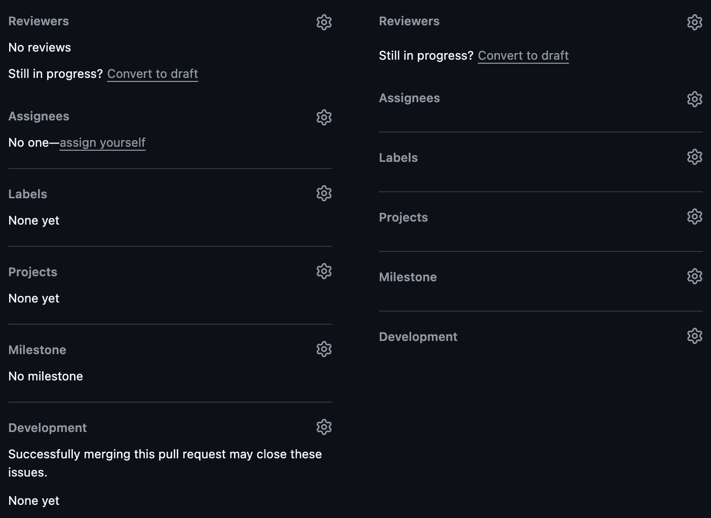
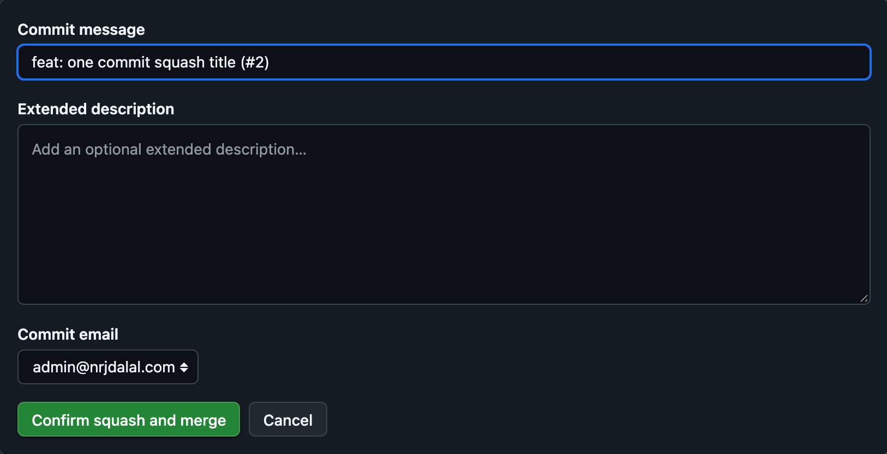
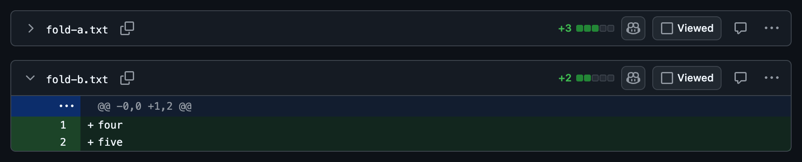

# GitHub Enhanced

Flash-free tweaks for github.com, as a browser extension. Every tweak lands as the page parses, before its first paint, so nothing flashes or shifts.

## Tweaks

### Dashboard sidebar

Home and Feed side by side, then two sections above "Top repositories": Pull Requests, linking to your chosen repos' pull requests, and All Repositories, linking to your chosen users' and orgs' repositories. Your avatar links to your profile.


### Navbar

The GitHub mark becomes a home button styled like the menu button.


### Repo tabs

Off until you list tabs in `repoTabs`. The tabs you list stay in the bar, in your order; the rest move under More at every width. Here `repoTabs` is `["code", "actions", "issues", "pull-requests"]`.


### Pull requests page

The "All pull requests" heading becomes three icon tabs with GitHub-style tooltips: Pull requests, Authored by me (your open pull requests) and Merged by me (your pull requests that were merged). Merged by me also joins the page's sidebar under Authored by me. They read your username from the page, so they show only when you are signed in. A repo's pull request lists open sorted by last update, so a pull request with a new comment or push comes first; a search that names its own `sort:` keeps it.


### Pull request sidebar

A box with nothing in it shows only its title: "No reviews", "No one assigned", "None yet" and "No milestone" are hidden, and so is Development's "Successfully merging this pull request may close these issues." while no issue is linked. Its gear still opens the box to fill it.



### Squash and merge title

Squash and merge fills its commit title with the pull request's title and number, as GitHub already does for a pull request of two or more commits; for one commit, GitHub would use that commit's message. Edit it before you confirm and your edit stays.



### Fold a file from its header

On a pull request's Files changed tab, a click on any empty part of a file's header bar folds or opens that file, as the arrow at its left does. Buttons and links in the bar, the file name included, work as before.



## Install

1. Clone or download this repo.
2. Open `chrome://extensions`, turn on **Developer mode** and click **Load unpacked**.
3. Pick the repo's folder.

It works in Chrome and other Chromium browsers, such as Helium, Arc, Brave and Edge.

## Settings

Click the extension's toolbar button, or its **Options**, to edit its config, one JSON object; `//` comments are allowed and kept. An empty config starts with commented-out examples. Open github.com tabs update as soon as you save.


```json
{
  "pullRequests": ["nrjdalal/zerostarter", { "vercel/next.js": "Next.js" }],
  "allRepositories": ["octocat", { "github": "GitHub" }],
  "repoTabs": ["code", "actions", "issues", "pull-requests"]
}
```

- `pullRequests` lists `owner/repo`, in order; each links to the repo's pull requests and shows as the repo's name, or as the label you give it with `{ "owner/repo": "Label" }`.
- `allRepositories` lists users and orgs, in order; each links to its repositories and shows as its name, or as the label you give it with `{ "name": "Label" }`. Whether a name is an org is learned once, from whether its `github.com/orgs/<name>` page exists, and kept in github.com's localStorage.
- `repoTabs` lists the repo tabs kept in the bar, in order, by their ids: `code`, `issues`, `pull-requests`, `agents`, `discussions`, `actions`, `projects`, `wiki`, `security-and-quality`, `insights`, `settings`. Leave it out to keep GitHub's own tab bar.

The config syncs through your browser profile. Avatars are kept in github.com's localStorage and refreshed after each dashboard load, so from the second visit on they paint with the page.

## Updates

With **Developer mode** on, the extension reloads itself once its folder changes, so `git pull` is all an update takes; the next github.com page load picks it up.

## License

MIT
