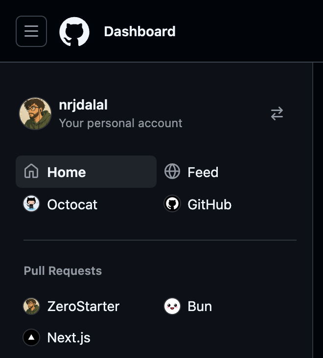
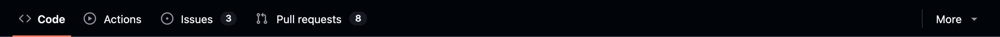
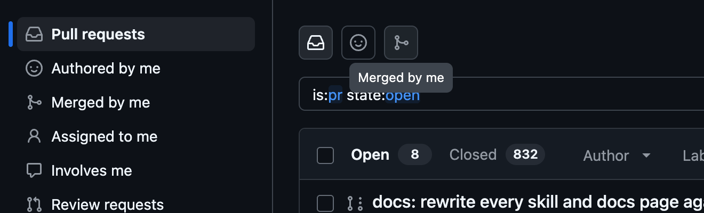
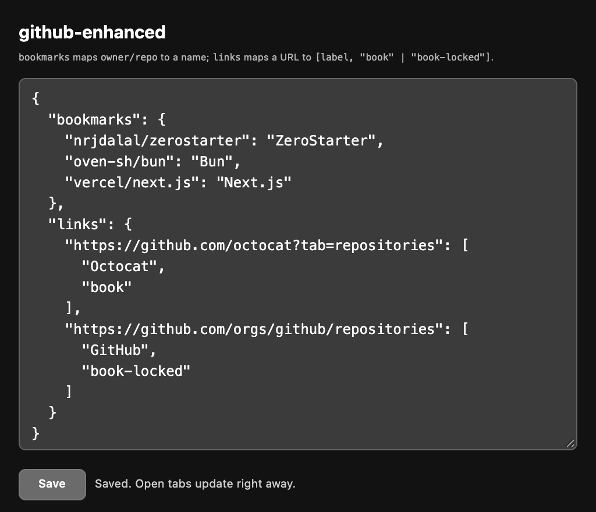

# github-enhanced

Flash-free tweaks for github.com, as a browser extension. Every tweak lands as the page parses, before its first paint, so nothing flashes or shifts.

## Tweaks

### Dashboard sidebar

Home and Feed side by side, your own links under them, a Bookmarks section above "Top repositories", and your avatar links to your profile.



### Navbar

The GitHub mark becomes a home button styled like the menu button.


### Repo tabs

Code, Actions, Issues and Pull requests stay in the bar; the rest move under More at every width.



### Pull requests page

The "All pull requests" heading becomes three icon tabs with GitHub-style tooltips: Pull requests, Authored by me (your open pull requests) and Merged by me (your pull requests that were merged). Merged by me also joins the page's sidebar under Authored by me. They read your username from the page, so they show only when you are signed in.



## Install

1. Clone or download this repo.
2. Open `chrome://extensions`, turn on **Developer mode** and click **Load unpacked**.
3. Pick the repo's folder.

It works in Chrome and other Chromium browsers, such as Helium, Arc, Brave and Edge.

## Settings

Click the extension's toolbar button, or its **Options**, to edit its config, one JSON object. Open github.com tabs update as soon as you save.



```json
{
  "bookmarks": {
    "nrjdalal/zerostarter": "ZeroStarter"
  },
  "links": {
    "https://github.com/octocat?tab=repositories": ["Octocat", "book"]
  }
}
```

- `bookmarks` maps `owner/repo` to the name shown in Bookmarks, in order.
- `links` maps a URL to a row under Home and Feed as `[label, icon]`, the icon `book` or `book-locked`.

The config syncs through your browser profile. Bookmark avatars are kept in github.com's localStorage and refreshed after each dashboard load, so from the second visit on they paint with the page.

## Updates

With **Developer mode** on, the extension reloads itself once its folder changes, so `git pull` is all an update takes; the next github.com page load picks it up.

## License

MIT
