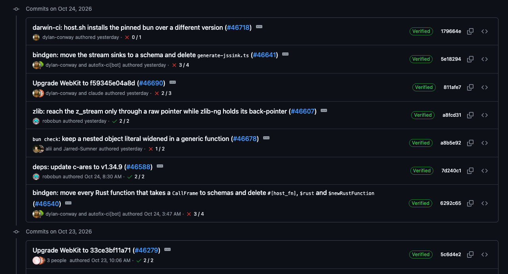
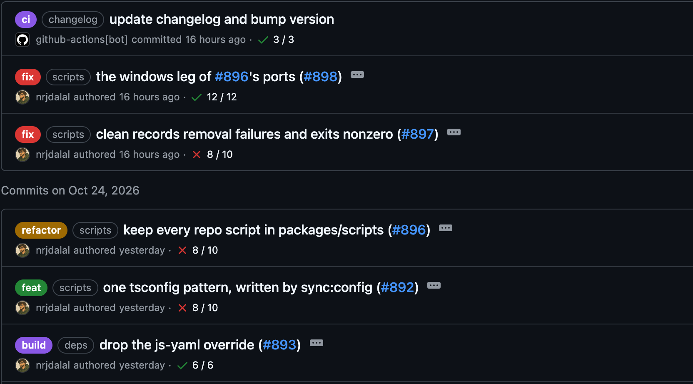
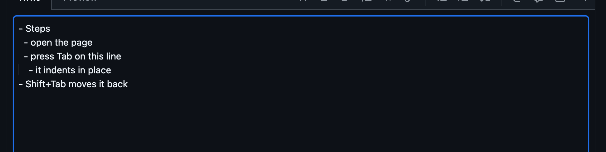
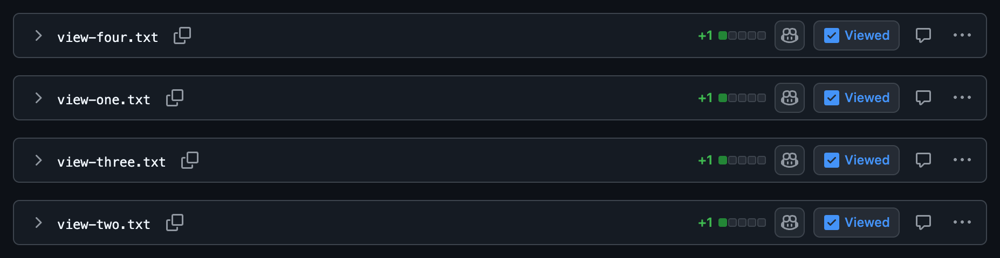

# GitHub Enhanced

Flash-free tweaks for github.com, as a browser extension. Every tweak lands as the page parses, before its first paint, so nothing flashes or shifts.

## Tweaks

### Dashboard sidebar

Home and Feed side by side, then two sections above "Top repositories": Pull Requests, linking to your open pull requests in your chosen repos (their Authored by me list), or to all their pull requests when you are signed out, and All Repositories, linking to your chosen users' and orgs' repositories. The same two sections sit above "Top repositories" in the menu the ☰ button opens on every page. Pull Requests also sits at the bottom of a repo's pull request sidebar when you are signed in, without its title and with the repo you are in among its rows. Your avatar links to your profile. The parts GitHub loads after the page (the Copilot box, Pull requests and Issues, "Top repositories" and the changelog) show as they were on your last visit at first paint, under a thin blue line across the top; when GitHub's own arrive, rows that moved slide to their place, new rows fade in, gone rows fade out, and the line runs to the right edge and fades.


### Navbar

The GitHub mark becomes a home button styled like the menu button.


### Repo tabs

Off until you list tabs in `repository.tabs`. The tabs you list stay in the bar, in your order; the rest move under More at every width. Here `repository.tabs` is `["code", "actions", "issues", "pull-requests"]`.


### Pull requests page

The "All pull requests" heading becomes four icon tabs with GitHub-style tooltips: Pull requests, Authored by me (your open pull requests), Merged by me (your pull requests that were merged) and Review • 5/5 (open pull requests labelled `Review • 5/5`). Merged by me and Review • 5/5 also join the page's sidebar under Authored by me. They read your username from the page, so they show only when you are signed in. A repo's pull request lists open sorted by last update, so a pull request with a new comment or push comes first; a search that names its own `sort:` keeps it.


### Copy a run's URL

An Actions run or job page gets a copy button after its title's number, which copies the page's URL and shows a check for two seconds.

### Recent pushes

The "had recent pushes" banner with its Compare & pull request button shows only for a branch you would merge into another one. It stays hidden for canary, dev, develop, main, master, prod, production and staging.

### Dates

A time from the last 36 hours stays relative, such as "just now", "3 minutes ago" or "yesterday". An older one shows its date and time in your time zone, such as "Oct 22, 4:27 AM", with the year when it is not this year. Hovering still shows the full date. Durations, such as a workflow run's "3m 20s", stay as they are.



### Commit types

In a repo's commit list, a pull request's Commits tab, pull request lists and a pull request's own heading, a title that starts with a [Conventional Commits](https://www.conventionalcommits.org) type shows the type as a colored label and its scope as a gray outline: `fix(scripts): clean records` reads as **fix** (scripts) clean records. The types are build, chore, ci, docs, feat, fix, perf, refactor, revert, style and test; a `!` for a breaking change stays on the label. A title that starts with a ticket key, such as `PLAT-2660: allow next-day viewings`, shows the key as a gray outline the same way. Labels are in place from the first paint, so titles do not shift when the page finishes loading. Any other title is left as it is.



### Pull request sidebar

A box with nothing in it shows only its title: "No reviews", "No one assigned", "None yet" and "No milestone" are hidden, and so is Development's "Successfully merging this pull request may close these issues." while no issue is linked. Its gear still opens the box to fill it.


### Squash and merge title

Squash and merge fills its commit title with the pull request's title and number, as GitHub already does for a pull request of two or more commits; for one commit, GitHub would use that commit's message. Edit it before you confirm and your edit stays.


### Tab to indent

In any text box, such as a comment, an issue or a pull request description, Tab indents the line, or every selected line, by 2 spaces, and Shift+Tab takes 2 spaces off. Undo reverts an indent in one step. Press Esc first and Tab leaves the box as before, so keyboard navigation still works.



### Fold a file from its header

On a pull request's Files changed tab, a click on any empty part of a file's header bar folds or opens that file, as the arrow at its left does. Buttons and links in the bar, the file name included, work as before.


### Mark many files as viewed

Click Viewed on one file, then shift-click Viewed on another: every file between them gets the same mark and folds. A shift-click on a viewed file unmarks the range; a plain click works as before.



## Install

1. Clone or download this repo.
2. Open `chrome://extensions`, turn on **Developer mode** and click **Load unpacked**.
3. Pick the repo's folder.

It works in Chrome and other Chromium browsers, such as Helium, Arc, Brave and Edge.

## Settings

Click the extension's toolbar button, or its **Options**, to edit its config, one JSON object; `//` comments are allowed and kept. An empty config starts with commented-out examples. Open github.com tabs update as soon as you save.

Or write it to `config.jsonc` in the extension's folder, which git ignores: with **Developer mode** on, the extension reloads, takes the file as its config and shows it under Options. It takes the file again only once its text changes, so edits saved under Options stay until then.


```json
{
  "sidebar": {
    "pullRequests": ["nrjdalal/zerostarter", { "vercel/next.js": "Next.js" }],
    "allRepositories": ["octocat", { "github": "GitHub" }]
  },
  "repository": {
    "tabs": ["code", "actions", "issues", "pull-requests"]
  },
  "tickets": {
    "PROJ": "https://linear.app/your-team/issue/{key}",
    "GH": "https://github.com/owner/repo/issues/{n}"
  }
}
```

- `sidebar.pullRequests` lists `owner/repo`, in order; each links to your open pull requests there (Authored by me), or to all its pull requests when you are signed out, and shows as the repo's name, or as the label you give it with `{ "owner/repo": "Label" }`.
- `sidebar.allRepositories` lists users and orgs, in order; each links to its repositories and shows as its name, or as the label you give it with `{ "name": "Label" }`. Whether a name is an org is learned once, from whether its `github.com/orgs/<name>` page exists, and kept in github.com's localStorage.
- `tickets` maps a ticket key's project to the URL its outline links to, `{key}` standing for the whole key (`PROJ-123`) and `{n}` for its number. A key in a title's scope (`fix(proj-123): …`) or at its start (`PROJ-123: …`) shows uppercased either way, and links once its project is listed.
- `repository.tabs` lists the repo tabs kept in the bar, in order, by their ids: `code`, `issues`, `pull-requests`, `agents`, `discussions`, `actions`, `projects`, `wiki`, `security-and-quality`, `insights`, `settings`. Leave it out to keep GitHub's own tab bar.

The config syncs through your browser profile. Avatars are kept in github.com's localStorage and refreshed after each dashboard load, so from the second visit on they paint with the page. The dashboard's last-visit copy is kept there too, as the page showed it when you left, tagged with your username: a copy saved by another account, or older than a week, is never shown.

## Updates

With **Developer mode** on, the extension reloads itself once its folder changes, so `git pull` is all an update takes; the next github.com page load picks it up.

## License

MIT
